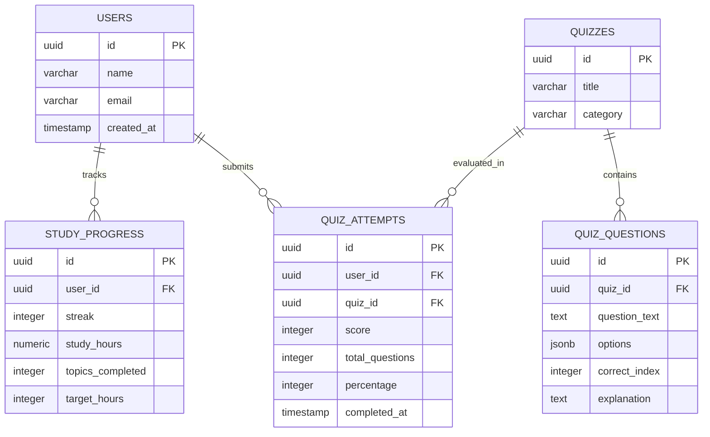

# Smart Study AI / Smart Study Learn 🎓

> **"Learn Smarter. Study Better."**

An intelligent, lightweight study companion designed to accelerate learning through an interactive AI Tutor, automated lecture note summarization, self-paced knowledge quizzes, and comprehensive progress analytics.

**GitHub Repository:** [https://github.com/ss37666555-cmyk/smart-study-learn](https://github.com/ss37666555-cmyk/smart-study-learn)  
**Academic Milestone:** Phase 2 Technical Review (incorporating unit testing, error boundaries, data schemas, and API architecture specifications).

---

## Table of Contents
1. [Project Overview](#1-project-overview)
2. [Current Architecture](#2-current-architecture)
3. [Features](#3-features)
4. [Technology Stack](#4-technology-stack)
5. [Application Data Flow](#5-application-data-flow)
6. [Error Handling & Defensive Boundaries](#6-error-handling--defensive-boundaries)
7. [Testing Strategy](#7-testing-strategy)
8. [Unit Test Coverage](#8-unit-test-coverage)
9. [Current Storage Schema](#9-current-storage-schema)
10. [API Status](#10-api-status)
11. [Proposed Future API](#11-proposed-future-api)
12. [Proposed Future Database Schema](#12-proposed-future-database-schema)
13. [Project Structure](#13-project-structure)
14. [How to Run](#14-how-to-run)
15. [How to Run Tests](#15-how-to-run-tests)
16. [Future Improvements & Roadmap](#16-future-improvements--roadmap)

---

## 1. Project Overview

College students frequently struggle with:
- **Information Overload:** Dense lecture transcripts and textbooks make extracting high-yield exam takeaways difficult.
- **Immediate Concept Blockers:** Waiting for office hours or asynchronous forum replies stalls study momentum.
- **Passive Study Inefficiencies:** Reading without active retrieval practice produces an illusion of competence.
- **Lack of Quantitative Tracking:** Without visual streaks and progress feedback, consistency diminishes.

**Smart Study AI** resolves these challenges by providing an integrated learning companion:
- **AI Study Tutor:** Immediate, structured explanations, ELI5 ("Explain Simply") breakdowns, and real-world analogies.
- **Notes Summarizer:** Converts messy lecture drafts into bulleted Key Points, Important Term glossary cards, and 60-second exam cram paragraphs.
- **5-Question Knowledge Quiz:** Self-paced multi-choice quizzes with instant grading and explanations.
- **Progress Tracker:** Visualizes daily study streaks (7 days), average quiz performance (85%), topics completed (12/15), and monthly hours (18h).

---

## 2. Current Architecture

The application uses a **browser-first, client-side modular architecture**. It operates completely in the browser without server dependencies, external CDNs, or third-party tracking scripts.

```
CURRENT RUNTIME ARCHITECTURE:
User
  ↓
Frontend UI (HTML5 Semantic Views + Responsive CSS3)
  ↓
Application Controller (script.js)
  ↓
Pure Domain Logic & Error Boundaries (utils.js)
  ↓
Data Persistence Layer (window.localStorage)
```

### Architectural Principles:
1. **Zero External Runtime Dependencies:** Inline SVG vector icons and native system fonts guarantee 100% offline functionality.
2. **Separation of Concerns:** Business logic, score calculations, and schema sanitization are isolated in pure functions within `utils.js`.
3. **Resilience & Graceful Degradation:** The quiz engine loads from `data/quiz-data.json` when served via HTTP/HTTPS, with automatic fallback to built-in datasets when opened via `file://` protocol.

---

## 3. Features

### 3.1 Unified Dashboard (`#tab-dashboard`)
- Branded header featuring the logo, tagline, and an animated 7-day study streak badge.
- Live metric cards: **7-Day Streak**, **85% Average Quiz Score**, **12/15 Completed Topics**, and **18 Study Hours**.
- Quick action cards (*"Ask AI"*, *"Summarize Notes"*, *"Take Quiz"*).
- Personalized daily recommended topics with 1-click review/study shortcuts.

### 3.2 AI Study Tutor (`#tab-ai-tutor`)
- Conversational chat interface with animated 3-dot typing indicator (600ms latency simulation).
- Pre-loaded domain knowledge:
  - **Photosynthesis:** *"Photosynthesis is the process by which green plants make their food using sunlight, water and carbon dioxide."*
  - **Newton's Laws of Motion:** Classical mechanics broken down by Law of Inertia, $F=ma$, and Action/Reaction.
  - **Mitosis vs. Meiosis:** Contrasting somatic repair (2 identical diploid cells) with gamete production (4 diverse haploid cells).
  - **Big-O Notation:** Growth rates from $O(1)$ and $O(\log n)$ to $O(n^2)$ with phonebook searching analogies.
- Quick action follow-up buttons under every AI bubble: `Explain Simply`, `Give Example`, and `Ask Another Question`.

### 3.3 Notes Summarizer (`#tab-summarizer`)
- Input textarea with character counter and a **"📋 Paste Sample Notes"** button for instant demo evaluation.
- Realistic loading state with animated spinner.
- Three structured output sections:
  - 📌 **Key Points:** High-yield concept highlights.
  - 🏷️ **Important Terms:** Domain glossary cards with concise definitions.
  - ⚡ **Quick Revision:** 60-second exam cram takeaway box.
- One-click **"Copy to Clipboard"** functionality.

### 3.4 5-Question Interactive Quiz (`#tab-quiz`)
- One-at-a-time question stepper with animated progress track ($20\% \rightarrow 100\%$).
- Clickable option cards (`A`, `B`, `C`, `D`) with active selection highlights.
- Results screen displaying:
  - Conic-gradient radial percentage score ring.
  - Correct and incorrect counters.
  - Performance feedback badge (*"Outstanding Mastery! 🏆"*).
  - Detailed review list showing chosen answers vs. correct answers with rationales.
  - Automatic synchronization with `localStorage` and the Dashboard.

### 3.5 Progress Analytics (`#tab-progress`)
- 7-day streak calendar bubbles (`M`, `T`, `W`, `T`, `F`, `S`, `S`).
- Color-coded progress bars for Quiz Accuracy (85%), Topics Completed (80%), and Study Hours (90%).
- Weekly study hours distribution bar chart (Mon–Sun).
- Interactive **"+ Log Study Session"** button that increments study hours and updates statistics in real time.

---

## 4. Technology Stack

| Layer | Technology | Rationale |
| :--- | :--- | :--- |
| **Markup** | HTML5 | Accessible, semantic document structure with ARIA attributes |
| **Styling** | Vanilla CSS3 | Modern CSS Grid, Flexbox, custom properties, responsive breakpoints, zero build tools |
| **Client Logic** | Vanilla JavaScript (ES6+) | Native event listeners, async DOM updates, universal exports |
| **Data Architecture** | JSON (`data/quiz-data.json`) | Separation of static question datasets from execution code |
| **Persistence** | Browser `localStorage` | Client-side persistent state management without backend requirements |
| **Unit Testing** | Node.js Test Runner (`node:test`) | Built-in test runner providing zero-dependency execution in <200ms |

---

## 5. Application Data Flow

```
+-------------------------------------------------------------------------+
|                              USER ACTIONS                               |
|   (Clicks Quick Action / Enters Query / Pastes Notes / Takes Quiz)      |
+-------------------------------------------------------------------------+
                                     │
                                     ▼
+-------------------------------------------------------------------------+
|                       APPLICATION CONTROLLER                            |
|             (script.js - Event Listeners & View Routing)                |
+-------------------------------------------------------------------------+
                                     │
                                     ▼
+-------------------------------------------------------------------------+
|                  CORE UTILITIES & VALIDATION ENGINE                     |
|                              (utils.js)                                 |
|                                                                         |
|  • validateUserData()          • calculateQuizScore()                   |
|  • validateNotesInput()        • calculateProgressPercentage()          |
|  • validateTutorQuery()        • validateQuizData()                     |
+-------------------------------------------------------------------------+
                                     │
                 ┌───────────────────┴───────────────────┐
                 ▼                                       ▼
+---------------------------------+   +-----------------------------------+
|      REACTIVE DOM UPDATES       |   |        PERSISTENCE LAYER          |
|  • Tab switching                |   |        (safeSaveData)             |
|  • Score radial ring            |   |                                   |
|  • Chat & typing animation      |   |  • JSON serialization             |
|  • Progress bar widths          |   |  • Quota & access error handling  |
|  • Non-blocking toast notices   |   |  • Key: "smartStudyAI_data"       |
+---------------------------------+   +-----------------------------------+
```

---

## 6. Error Handling & Defensive Boundaries

The project implements comprehensive client-side error handling via reusable helpers in `utils.js` and global listeners in `script.js`:

### 6.1 `localStorage` Error Boundaries
- **Storage Unavailable / Security Restrictions:** When running inside private browsing windows where storage access is blocked, `safeLoadData()` catches `SecurityError` and falls back cleanly to `DEFAULT_USER_DATA`.
- **Corrupted JSON Recovery:** If the stored JSON string is corrupted, `safeLoadData()` intercepts `SyntaxError`, logs a diagnostic notice, and restores the default state without crashing the page.
- **Schema Sanitization:** `validateUserData()` verifies all 8 fields, ensuring numerical bounds (e.g. `quizScore` between 0–100, `streak >= 0`). Invalid values are sanitized to defaults.
- **Quota Management:** `safeSaveData()` catches `QuotaExceededError` and alerts the user with a friendly toast notification.

### 6.2 Quiz Engine Boundaries
- **Fetch Fallback:** If `data/quiz-data.json` fails to load (e.g. `file://` CORS restrictions), the app falls back to `DEFAULT_QUIZ_DATA`.
- **Question Validation:** `validateQuizQuestion()` and `validateQuizData()` check that every question contains valid prompt text, at least two options, and a valid `correctIndex`.
- **Score Protection:** `calculateQuizScore()` handles empty question sets, unanswered questions, and negative answer indices safely without throwing `NaN` or divide-by-zero errors.

### 6.3 Notes Summarizer Boundaries
- **Empty / Whitespace Detection:** Rejects empty or whitespace-only inputs.
- **Length Limits:** Enforces an upper boundary of 50,000 characters to prevent browser memory exhaustion.
- **Content Sanity:** Rejects inputs with fewer than 15 alphanumeric characters.

### 6.4 AI Tutor Boundaries
- **Query Validation:** Checks for non-empty text and enforces a 1,000-character upper limit.
- **XSS Prevention:** All user inputs and subject topics are escaped via `escapeHtml()`.

### 6.5 Global JavaScript Error Catchers
```javascript
window.addEventListener('error', (event) => {
  console.error("[Global Error]:", event.message, event.error);
  showError("An unexpected error occurred. Please refresh or retry.", event.error);
});

window.addEventListener('unhandledrejection', (event) => {
  console.error("[Unhandled Promise Rejection]:", event.reason);
  showError("A background operation could not be completed. Please try again.", event.reason);
});
```
Raw technical stack traces are never exposed to the student in the UI; clean notifications are displayed while diagnostic details are logged to `console.error`.

---

## 7. Testing Strategy

The testing strategy isolates pure business and mathematical logic from the browser DOM:
- **Zero-Dependency Native Runner:** Uses Node.js's built-in `node:test` and `node:assert` modules.
- **Granular Coverage:** 48 dedicated unit tests across 16 test suites covering positive, negative, boundary, and error-handling conditions.
- **Mock Storage:** Emulates the W3C Web Storage API to test quota limits and corrupted JSON recovery in headless environments.

Detailed testing documentation is available in [`docs/TESTING.md`](docs/TESTING.md).

---

## 8. Unit Test Coverage

```
▶ Progress Percentage Calculations
  ▶ Standard Academic Metric Cases (12/15 topics, 18/20 hours, 5/10)     ✔ 3 passed
  ▶ Boundary Value Cases (0/15, 15/15, 25/20 capped, 25/20 uncapped)    ✔ 4 passed
  ▶ Defensive Edge Cases (divide-by-zero, negative numbers, strings, NaN) ✔ 6 passed
▶ Quiz Score Calculation
  ✔ 5/5 correct = 100%                                                  ✔ 1 passed
  ✔ 4/5 correct = 80%                                                   ✔ 1 passed
  ✔ 2/5 correct = 40%                                                   ✔ 1 passed
  ✔ 0/5 correct = 0%                                                    ✔ 1 passed
  ✔ DEFAULT_QUIZ_DATA compatibility                                     ✔ 1 passed
  ▶ Edge Cases (empty array, null/undefined, partial answers, bad types) ✔ 5 passed
▶ Storage & Persistence Error Boundaries
  ▶ Standard Save and Load                                              ✔ 2 passed
  ▶ Corrupted JSON and Malformed Data Recovery                          ✔ 2 passed
  ▶ Storage Access & Quota Error Boundaries                             ✔ 3 passed
  ▶ validateUserData helper unit tests                                  ✔ 2 passed
▶ Validation & Data Defense Unit Tests
  ▶ Quiz Question Validation (validateQuizQuestion)                     ✔ 4 passed
  ▶ Full Quiz Dataset Validation (validateQuizData)                     ✔ 3 passed
  ▶ Notes Summarizer Input Validation (validateNotesInput)              ✔ 5 passed
  ▶ AI Tutor Query Validation (validateTutorQuery)                      ✔ 4 passed

Total Test Assertions: 48 passed | 0 failed (100% Success Rate)
Execution Time: ~180 ms
```

---

## 9. Current Storage Schema

The current application stores a single serialized object under the key `smartStudyAI_data`:

| Field | Type | Description | Default Value | Validation Rules |
| :--- | :--- | :--- | :--- | :--- |
| `userName` | `string` | Display name of the active student | `"Alex Morgan"` | Non-empty string, max 100 characters |
| `streak` | `number` (int) | Consecutive active days | `7` | Integer $\ge 0$, max 3650 |
| `quizScore` | `number` (int) | Average or latest quiz score percentage | `85` | Integer between $0$ and $100$ |
| `topicsCompleted` | `number` (int) | Topics completed in syllabus | `12` | Integer between $0$ and `totalTopics` |
| `totalTopics` | `number` (int) | Total topics in curriculum unit | `15` | Positive integer $\ge 1$ |
| `studyHours` | `number` (int) | Total study hours logged this period | `18` | Integer $\ge 0$, max 10000 |
| `targetHours` | `number` (int) | Monthly target hours goal | `20` | Positive integer $\ge 1$ |
| `quizzesTaken` | `number` (int) | Total count of quizzes completed | `4` | Integer $\ge 0$ |

Complete storage schema documentation is located in [`docs/DATABASE_SCHEMA.md`](docs/DATABASE_SCHEMA.md).

---

## 10. API Status

> **Current Implementation Status: NOT IMPLEMENTED (Client-Side Prototype)**  
> The current version does not make remote HTTP API calls. All tutoring simulations, notes processing, and quiz evaluations execute locally in browser memory.

---

## 11. Proposed Future API

For Phase 2 development, a RESTful API will replace client-side simulation.

```
FUTURE CLIENT-SERVER ARCHITECTURE:
User
  ↓
Frontend (Browser)
  ↓
REST API (HTTPS / JSON / JWT)
  ↓
Backend (Node.js / Express or Python / FastAPI)
  ↓
Database (PostgreSQL / Relational Store)
```

### Proposed Endpoint Summary:
- `GET /api/v1/users/:id` — Fetch student profile
- `GET /api/v1/progress/:userId` — Retrieve streak, study hours & topic progress
- `POST /api/v1/progress` — Record a study session increment
- `GET /api/v1/quizzes` — List available quizzes by subject
- `GET /api/v1/quizzes/:id` — Retrieve quiz question set (without server answers)
- `POST /api/v1/quizzes/:id/attempts` — Submit quiz answers for server-side grading
- `GET /api/v1/users/:id/quiz-attempts` — Historical quiz performance and trend analytics

Complete API endpoint documentation with sample request/response payloads is available in [`docs/API.md`](docs/API.md).

---

## 12. Proposed Future Database Schema

When transitioning to a relational database (PostgreSQL), the data will be normalized into 4 relational tables:



Detailed table specifications and migration plans are documented in [`docs/DATABASE_SCHEMA.md`](docs/DATABASE_SCHEMA.md).

---

## 13. Project Structure

```
smart-study-learn/
│
├── index.html                  # Main application entry point & markup
├── style.css                   # Responsive design system & animations
├── script.js                   # Application controller & DOM wiring
├── utils.js                    # Pure business logic, validators & error boundaries
├── package.json                # Project manifest & test runner configuration
├── README.md                   # Comprehensive project documentation
│
├── data/
│   └── quiz-data.json          # Separated static quiz dataset
│
├── tests/
│   ├── quiz.test.js            # Unit tests: quiz calculations & score boundaries
│   ├── progress.test.js        # Unit tests: progress percentages & zero division
│   ├── storage.test.js         # Unit tests: localStorage defense & quota handling
│   └── validation.test.js      # Unit tests: quiz question, notes & tutor validators
│
└── docs/
    ├── TESTING.md              # Technical testing strategy & test case catalog
    ├── API.md                  # Current API status & proposed REST API specification
    └── DATABASE_SCHEMA.md      # Current localStorage schema & future database ERD
```

---

## 14. How to Run

Smart Study AI runs in any modern web browser with **zero backend installation and no API keys required**.

### Option 1: Direct File Opening
1. Double-click `index.html` (or `smart-study-ai/index.html`) in your file explorer.
2. The application opens immediately in your default web browser (Chrome, Edge, Firefox, Safari).

### Option 2: Using a Lightweight Local HTTP Server (Recommended)
```bash
# Using Python 3
python -m http.server 8000

# Or using npx
npx serve .
```
Then navigate to `http://localhost:8000` in your web browser.

---

## 15. How to Run Tests

### Prerequisites
- Node.js version 18.0.0 or higher.
- No external packages or `npm install` needed!

### Commands
```bash
# Run all 48 unit tests
npm test

# Run tests in watch mode (auto re-runs on file changes)
npm run test:watch

# Run tests with verbose reporter
npm run test:verbose

# Run directly via Node.js
node --test smart-study-ai/tests/*.test.js
```

---

## 16. Future Improvements & Roadmap

1. **LLM Integration:** Connect backend API to Gemini or Claude APIs for unbounded conversational tutoring and automated note synthesis.
2. **Audio Lecture Transcription:** Implement Whisper-based speech-to-text to summarize recorded classroom audio.
3. **Spaced Repetition System (SRS):** Full SM-2 algorithm implementation for personalized daily flashcard reviews.
4. **Cloud Authentication:** User sign-up, password hashing with Argon2id, and multi-device study streak synchronization.
5. **Document Export:** Export generated summaries directly to PDF, Markdown, Notion, or Obsidian.

---

## 📄 License
MIT License. Created as an educational software prototype for **Smart Study AI / Smart Study Learn**.
